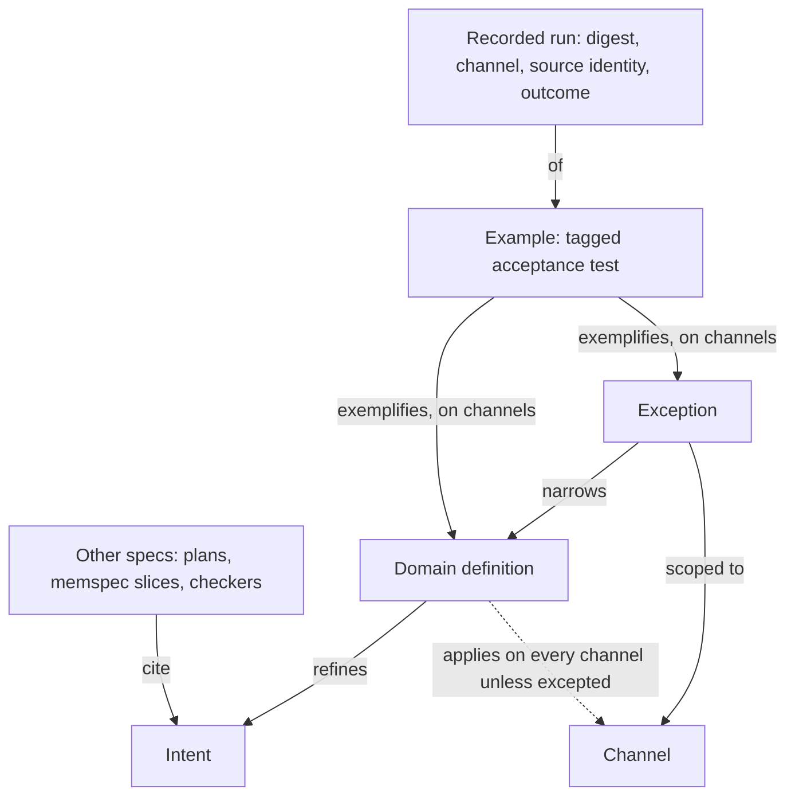
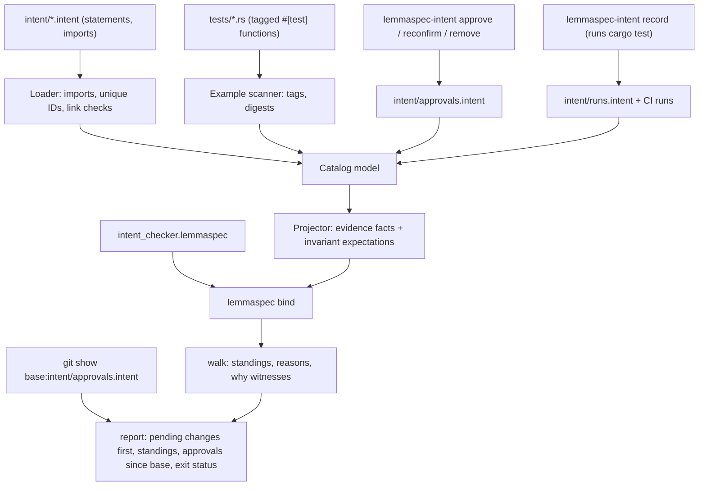
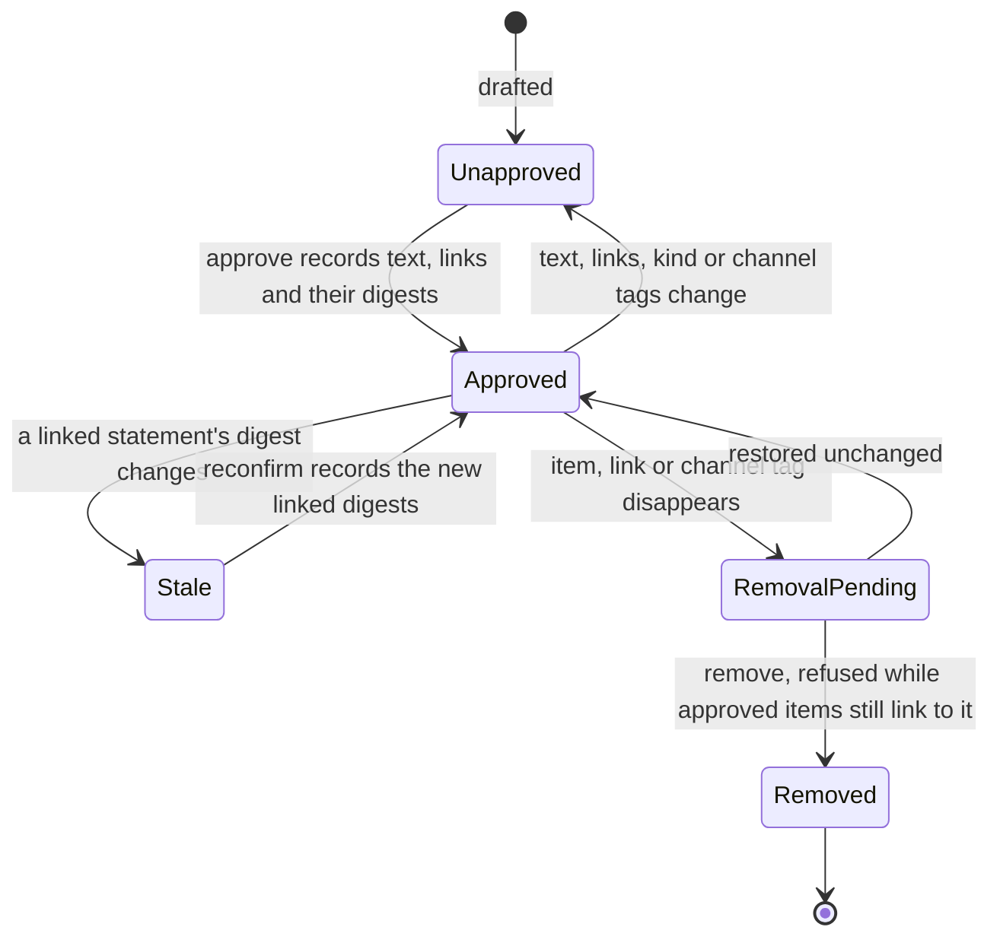

# Intent Catalog - Plan

## Goal Capsule

- **Objective:** A developer working with coding agents can tell, for any commit, which approved intents, domain definitions and exceptions are proven by examples that have been seen failing and that pass on every channel they apply to, and which are unapproved, stale or unverified.
- **Means:** a typed `.intent` catalog read by an optional `lemmaspec-intent` tool that projects it into LemmaSpec evidence for a bundled checker, with lemmaspec itself as the first adopter (KTD1, KTD2, KTD8).
- **Product authority:** The repository owner decides who approves statements and examples; the catalog records approvals and surfaces every change awaiting one. This plan covers the intent model, its verified-statement report, and run recording for one test framework. Execution binding beyond that framework, toolset packaging, code tie-in and an approval UI are not active scope.
- **Stop conditions:** Stop and re-plan if the checker cannot be expressed without changing LemmaSpec's core (R26), or if example digests cannot be made identical across the Linux, macOS and Windows CI runners.
- **Execution profile:** Deep. Units land as separate commits on a feature branch; once U1's crate scaffold exists, U3 can proceed in parallel with U2, U4 and U5.
- **Who finishes:** `ce-work` implements and verifies the units. The repository owner records the approvals for lemmaspec's own catalog before merge, because CI stays red until they exist (R16).
- **Open blockers:** None.

---

## Product Contract

### Summary

A typed intent catalog lives in a project's repository next to its code. It holds approved intents, the domain definitions that refine them, exceptions that narrow a definition for named channels, and the project's channels, all joined by typed links. The project's own acceptance tests point at the statement they exemplify, and a checker reports which statements are verified at a given commit. An optional `lemmaspec-intent` tool reads the catalog, its approval log and its run ledger, records runs from `cargo test`, and renders that report through LemmaSpec; lemmaspec adopts it first for its own command-line and library behavior.

### Problem Frame

Coding agents now write more code than a person can review, so what keeps a system aligned with intent is a check that runs and that agents cannot quietly weaken. Practitioners report the opposite happening: agents delete failing tests or edit them until they pass. Markdown specs record intent but never run. Tests run, but no test is tied to an approved statement, and nothing notices when an approved check changes.

Two cases shaped this plan. In a CRM, the intent "a consultant always knows when to follow up on each open sales process" was first realized as a next-touch date on each sales process. Consultants actually steer by their next task, so the follow-up became the due date of the earliest open task. The intent survived; the meaning of "next follow-up" changed. The old date was read by the dashboard, the filters, inline editing, an import job and several MCP tools, so a browser channel and an agent channel both depended on the old meaning. Nothing recorded which places still used it or whether the passing tests still checked the right thing.

In the second case, an app that serves only browser-authenticated users adds API, MCP and agent clients, and later a public area. "Every request is authenticated by a browser session" turns out to be a mechanism. The intent that lasts is that private data is visible only to an allowed principal. Each new channel, and the public area, is a change someone must approve and that every existing definition must account for.

The existing tools each cover part of this. LemmaSpec evaluates evidence deterministically but has no notion of intent. In `crates/lemmaspec-plan`, requirements are labels, and acceptance claims can attach only to units and gates. memspec links slices and keeps hash-chained history, but it models coupled state, not intent. The surveyed landscape has the same gap: no tool links an approved statement to evidence that its check failed before it passed (`docs/research/2026-10-22-executable-spec-landscape.md`, cross-cutting observations).

### Key Decisions

- **The scope is the intent model.** Execution binding and toolset packaging follow as separate plans that reuse its vocabulary. (session-settled: user-approved — chosen over starting with execution binding or toolset shape: both depend on the intent model's terms.)
- **Domain definitions are an approved layer between intent and code.** A change of meaning needs sign-off; a change of code behind an unchanged definition does not. Governs R2, R21. (session-settled: user-approved — chosen over rewriting the intent on every meaning change, or leaving definitions to agents: the follow-up case changed meaning without changing intent.)
- **A definition holds on every channel unless an approved exception scopes it out.** Governs R3, R4. (session-settled: user-approved — chosen over per-channel opt-in, or keeping channels out of intent: a new channel must not silently skip an intent.)
- **The first deliverable is the verified-statement report.** Governs R17, R18, R19, R20, R21, R22, R23, R24, R29. (session-settled: user-approved — chosen over change impact, orphan detection and a channel coverage view: it needs no code facts.)
- **The catalog is a typed, linked format, not Markdown, and examples are the project's own tagged tests.** Typed links let a change be traced to everything that depends on it. Governs R5, R6, R7, R8, R9, R28. (session-settled: user-directed — chosen over a Markdown catalog: references must be checkable so dependent changes can be tracked.)
- **Exceptions narrow definitions, never intents.** An intent that needs an exception is stated at the mechanism level, as "authenticated by a browser session" was. Governs R3.
- **Exceptions come in two kinds.** One states that a definition does not apply on a channel; the other states what holds there instead and carries its own examples. Governs R3, R18, R19, R21. (session-settled: user-approved — chosen over requiring a tested exception for every channel a definition does not concern: each new channel would force placeholder examples onto unrelated definitions.)
- **Run recording for one test framework is in scope.** Without it the plan could be finished on fixture runs while no real project ever gets a report. Governs R11. (session-settled: user-approved — chosen over narrowing the objective to fixture-only runs: the objective is a report for any real commit.)
- **lemmaspec is the first adopter.** Its own `cargo test` suite is the first framework, and its catalog proves the success criteria in its own CI. Governs R11. (session-settled: user-approved — chosen over the CRM on Rails/minitest and over a private Rust repository: one public repo keeps the end-to-end proof in this repo's CI.)
- **A failing run may come from a deliberately broken scratch version of the source.** Behavior that already works has no natural failing run, so requiring red on an earlier commit would leave it unverified forever. Governs R20. (session-settled: user-approved — chosen over requiring red on an earlier commit or a killed mutant: old commits may no longer build, and mutation testing stays deferred.)
- **Change is surfaced, not policed.** Anyone, human or agent, may draft or approve; the catalog records each approval in the catalog itself and makes every change to intent loud until an approval is recorded. Who may approve, and how strongly that is checked, is the project's own policy. Governs R12, R13, R14, R15, R16, R27. (session-settled: user-directed — chosen over designated approvers and signed approvals: trust is a deployment choice, and the catalog's job is to make every change to intent visible so it can be approved.)
- **The catalog is an optional companion to LemmaSpec.** A project adopts it one statement at a time, and LemmaSpec without the catalog is unchanged. Governs R25, R26.

### Requirements



**Catalog statements**

- R1. The catalog declares four kinds of statement: intent, domain definition, exception and channel. Each statement has required prose text and a stable ID that is unique across every file of the catalog.
- R2. A domain definition refines one intent and states what a domain term means for the system, such as "a process's next follow-up is the due date of its earliest open task".
- R3. An exception narrows one definition for named channels, either by stating that the definition does not apply there or by stating what holds there instead.
- R4. A definition applies on every approved channel except the channels named by its approved, non-stale exceptions.

**Links and files**

- R5. Statements link to each other with typed links, and each link points from the dependent statement to the statement it depends on.
- R6. A catalog can span several files that import one another, and a reference across files resolves and is checked exactly like one within a file.
- R7. An unknown reference, a cycle, a duplicate ID across files, or a link between the wrong kinds of statement is an error that names the offending reference.
- R8. Artifacts outside the catalog (examples, plans, memspec slices, LemmaSpec checkers) may cite a statement by its bare ID, while the catalog's only references to other files are the imports R6 allows.

**Examples and runs**

- R9. An example is an acceptance test in the project's own test code that names the definition or exception it exemplifies and the channels it runs on.
- R10. The report reads recorded runs, each naming the example, the example's digest at run time, the channel, the source identity it ran against and the outcome, and failing runs are kept as evidence.
- R11. The first version reads tagged examples from one test framework, chosen by the first project to adopt the catalog, computes each example's digest, and records every run with its outcome, failures included.
- R28. An example whose tag names an unknown statement, a statement it cannot exemplify, or a channel its statement does not apply on is reported with that reason and does not count, without stopping the report.

**Approval**

- R12. Anyone, human or agent, may draft and change statements and examples, and approval is a separate, explicit step recorded in the catalog itself that names the approver, the digest of the approved text, and the digest of each statement the item links to.
- R13. A statement or example whose current text differs from its latest approval is unapproved.
- R14. An item is stale when a statement it links to no longer has the digest recorded at the item's last approval or re-confirmation, and it stays stale until it is re-confirmed.
- R15. Removing an approved statement or example, or one of its approved links or channel tags, is a change that needs approval, and until it is approved the report treats the removed item or link as still present, with no passing run, and names the removal as the reason.
- R16. The report opens with every change awaiting approval (changed, added and removed statements and examples, and stale dependents) and exits with a failing status while any remain.

**Verified-statement report**

- R17. For a given commit, the report gives every intent, definition and exception exactly one standing, the first that applies in the order unapproved, stale, unverified, verified.
- R18. A definition, or an exception that states what holds instead, is verified when it and its examples are approved as they read now and none is stale, it applies on at least one channel, each such channel has at least one example tagged for it, and every example tagged for that channel has failed on that channel with its current text and passes on that channel at the commit.
- R19. An exception that states only that a definition does not apply is verified when it is approved and not stale.
- R20. The failing run that R18 requires may come from any version of the source, including an uncommitted scratch break, and need not come before the passing run.
- R21. An intent is verified when it is approved and every definition refining it, and every exception narrowing those definitions, is verified, and an intent with no definitions is unverified.
- R22. Every standing other than verified states its reason, such as a missing approval, example, channel or failing run, traced back to the facts it rests on.
- R23. The same catalog, approval log, recorded runs and target commit always produce the same report.
- R24. The report renders for a human reader, showing each statement's prose, links and standing.
- R29. Only a run in which the example itself ran and failed counts as a failing run, so a build error, a skip or a missing test does not, and a failing run on a channel at the target commit keeps that example from passing there.

**Adoption**

- R25. A catalog with a single statement produces a useful report, and statements without examples show as unverified without blocking the rest.
- R26. LemmaSpec stays usable without the catalog, and its core gains no dependency on it.

**Change review**

- R27. Given a base commit, the report also lists the approvals recorded between the base and the target, naming each approver, so approvals are reviewable like any other change.

### Acceptance Examples

- AE1. **Covers R18.**
  - **Given:** the definition "next follow-up is the due date of the earliest open task" and its example are approved; the example failed with its current text and passes at the commit on the browser and MCP channels; no exception applies.
  - **When:** the report runs.
  - **Then:** the definition is verified.
- AE2. **Covers R13, R18.**
  - **Given:** AE1, except that an agent edited the example after its failing run, and the edited example passes.
  - **When:** the report runs.
  - **Then:** the example is unapproved and the definition is not verified.
- AE3. **Covers R13, R14.**
  - **Given:** the follow-up definition changes from "the next-touch date the consultant sets" to "the due date of the earliest open task".
  - **When:** the report runs.
  - **Then:** the definition is unapproved, and its examples and the exception narrowing it are stale. After the new definition text is approved, they stay stale until each is re-confirmed.
- AE4. **Covers R4, R18.**
  - **Given:** an MCP channel is added to the catalog and approved.
  - **When:** the report runs.
  - **Then:** every definition without an exception for MCP becomes unverified, with the missing MCP example as its reason, until it has an MCP example that has failed and passes.
- AE5. **Covers R3, R4, R18.**
  - **Given:** an approved exception "public pages need no principal and show no private data" narrows the private-data definition for the public channel and has its own approved example that has failed and passes.
  - **When:** the report runs.
  - **Then:** the private-data definition needs no example on the public channel, and the exception is verified.
- AE6. **Covers R7.**
  - **Given:** an exception links to a definition ID that does not exist.
  - **When:** the catalog is checked.
  - **Then:** the check fails with an error naming the unknown reference.
- AE7. **Covers R21, R25.**
  - **Given:** a catalog holding one approved intent and nothing else.
  - **When:** the report runs.
  - **Then:** the report completes and shows the intent as unverified because no definition refines it.
- AE8. **Covers R15, R18.**
  - **Given:** the private-data definition has two approved browser examples, one passing and one failing, and an agent deletes the failing one without an approved removal.
  - **When:** the report runs.
  - **Then:** the definition is unverified, and the reason names the removed example.
- AE9. **Covers R19, R4.**
  - **Given:** an approved exception states that the follow-up definition does not apply on the public channel, and no public example exists.
  - **When:** the report runs.
  - **Then:** the exception is verified by its approval, and the follow-up definition needs no example on the public channel.
- AE10. **Covers R20.**
  - **Given:** an MCP tool already returns the next follow-up correctly, and its new approved example passes at every real commit but failed on a scratch break of that tool.
  - **When:** the report runs.
  - **Then:** the follow-up definition is verified on the MCP channel.
- AE11. **Covers R16, R27.**
  - **Given:** an agent changes the follow-up definition's text and records an approval for it in the same change.
  - **When:** the report runs against the target with the previous main commit as base.
  - **Then:** the report lists that approval as recorded since the base, naming who approved, so the change cannot pass unnoticed in review.
- AE12. **Covers R18.**
  - **Given:** a catalog with one approved intent, one approved definition and no approved channel.
  - **When:** the report runs.
  - **Then:** the definition is unverified because it applies on no channel.
- AE13. **Covers R13.**
  - **Given:** the follow-up definition was approved with text A, then re-approved with text B, and an agent reverts its text to A.
  - **When:** the report runs.
  - **Then:** the definition is unapproved, because only the latest approval counts.
- AE14. **Covers R15.**
  - **Given:** the private-data definition has two approved browser examples, one passing and one failing, and an agent re-tags the failing one to a different definition.
  - **When:** the report runs.
  - **Then:** the private-data definition is unverified, and the reason names the removed link.
- AE15. **Covers R29.**
  - **Given:** an approved example has a failing run on an earlier scratch break, and both a pass and a fail on the browser channel at the target commit.
  - **When:** the report runs.
  - **Then:** the example does not pass on the browser channel, and its definition is unverified.
- AE16. **Covers R6, R14.**
  - **Given:** a fully verified catalog whose statements are moved into a newly imported file, with no change to any prose or link.
  - **When:** the report runs.
  - **Then:** every standing is unchanged and nothing awaits approval.
- AE17. **Covers R18.**
  - **Given:** an approved example tagged for the browser and MCP channels has a failing run on browser only, and passes on both at the target.
  - **When:** the report runs.
  - **Then:** its definition is unverified, with no failing run on MCP as the reason.
- AE18. **Covers R29.**
  - **Given:** the only failing run recorded for an approved example is a build error on a scratch break.
  - **When:** the report runs.
  - **Then:** the example has no failing run, and its definition is unverified.
- AE19. **Covers R28.**
  - **Given:** a test is tagged as an example of a statement ID the catalog does not declare.
  - **When:** the report runs.
  - **Then:** the report completes, lists the example as ignored with the unknown statement as the reason, and no standing counts it.

### Success Criteria

- Every acceptance example runs as an automated test: the standing-level ones as the checker's own fixture, and AE6, AE11, AE16 and AE19 against the catalog tool.
- The checker's mutation policies leave no surviving mutants, so every rule and condition is load-bearing for that fixture.
- On the first project to adopt the catalog, the report at a real commit shows at least one definition verified from that project's own tagged tests and recorded runs, and editing one of those tests turns it unapproved.

### Scope Boundaries

**Deferred for later**

- How each test framework tags examples and records runs, beyond the one framework the first version needs.
- Packaging: whether the catalog tool lives with LemmaSpec, with the code-fact extractor, or in a merged toolset.
- Change impact into code and detection of code no approved statement reaches. Both need code facts, and attribute reads such as an ORM column accessor are not resolved call edges today.
- A channel coverage view beyond what the report's standings already show.
- An approval ledger that records why each approval was given; git history is the record for now.
- Semantic comparison of statement versions, such as Cedar's check of whether a new policy version permits more than the old one.
- A TUI or GUI for walking the catalog and approving pending changes.
- Code mutation testing as evidence of how strong an example is.

**Outside this product's identity**

- Generating code from the catalog.
- Counting a model grader's verdict as verification.
- Authenticating approvers, enforcing who may approve, or signing approvals.

**Considered and not built**

- Rejecting approvals or runs forged on a branch. Change is surfaced, not policed: a forged approval still shows in the approvals listed since the base (R27). Evidence of forged runs reaching a merge would change this.
- Isolating the recorder from test hooks or harness configuration at the version under test. A hook that turns failures into passes is out of reach of example digests; CI regenerates green from the committed tree, so the hook change is itself reviewable. Evidence of such a hook surviving review would change this.
- Covering shared helpers, fixtures and channel drivers in an example's digest. The digest covers the test function and its tag (KTD4); tracing helpers per framework is costly, and a weakened helper remains a documented gap.
- Preserving scratch breaks under a reserved git ref. Standings never need the scratch source to resolve; the run record keeps its source identity and base commit for traceability.
- A second installable agent skill for the catalog. An `intro` command and one pointer line in the existing skill carry the guidance (KTD12).

**Deferred to Follow-Up Work**

- A Markdown or HTML diff of old and new prose in the pending-approval list beyond what the approval log's stored text already shows.

### Dependencies / Assumptions

- The existing status producer turns only passing gates into `observed` facts, so the recorder in R11 (one-framework run recording) is new work.
- The catalog does not verify who approved or who recorded a run. Whether an approval is trustworthy is the project's own policy, such as who may merge changes to the catalog; LemmaSpec's basis metadata likewise does not authenticate authorship.
- Test code an example calls outside its digest, such as shared steps, helpers, fixtures and channel drivers, is not protected by approval (KTD4).
- Cross-file references follow memspec's import model: `use "<path>" as <alias>`, qualified IDs, cycles rejected, and a file imported along two paths loaded once. `alias.id` is only how one catalog file refers into another; artifacts outside the catalog cite the bare ID.
- Recording runs and reading the base commit's approval log need `git` on the path. The report and the checker never execute project code; only `record` does.

<!-- ce-section: work-relationships -->
### How This Work Fits Together

This plan covers the intent model, its verified-statement report, and run recording for one test framework. The areas below are the current understanding, not a committed roadmap.

- **Execution binding:** Depends on this plan's statement and example IDs and its first-framework recorder. It extends run recording to further test frameworks and channels.
- **Toolset shape:** Can proceed independently of execution binding. Still to decide: whether the catalog tool lives with LemmaSpec, with the code-fact extractor, or in a merged toolset.
- **Code tie-in** (change impact, unreached code, channel coverage): Depends on this plan and on code facts. Shares this plan's link direction, with code-level facts pointing up at statements.
- **Approval UI:** Depends on this plan's approval step and its unapproved and stale standings.

### Sources / Research

- `docs/research/2026-10-22-executable-spec-landscape.md`: a survey of the people, tools and practices Dave Farley cites on executable specifications, plus adjacent tools, mapped to intent, executable, design, code-fact, evidence and process layers.
- `docs/research/2026-10-22-behavior-checker-sketch.lemmaspec`: a working LemmaSpec sketch of approval by digest, red then green with unchanged text, orphan scenarios and unrequested code. `walk` is clean, and `mutate` kills 33 mutants with none surviving.
- `crates/lemmaspec-plan/src/lib.rs`: the consumer pattern this crate mirrors, including the projector (`project_plan`), the embedded `CHECKER`, basis stamping and deterministic sorting, and `compose_status` evidence validation.
- `crates/lemmaspec-plan/tests/project.rs`: the checker self-test (`mutate_artifact(CHECKER)` is clean) and the determinism and bind-to-render tests to copy.
- `src/guide/index.rs` (`observation_identity_mismatch`) and `src/main.rs` (`render --target-identity`): why off-target runs must not be `observed` facts carrying an identity (KTD10).
- `src/eval/stratify.rs` (`validate_rule_safety`, aggregate validation): negation with `_` is safe, and `count` yields no row for an empty group, so "no example" is written as a negation.
- `src/artifact/parser.rs`: fact IDs must be bare identifiers, while symbols may be quoted strings.
- memspec `crates/memspec-parser/src/analysis/loader.rs` and `docs/grammar-v0.md` ("Imports"): the loader and import model KTD3 mirrors.
- memspec `crates/memspec-parser/src/analysis/revisions.rs` (`canonical_source_projection`): the precedent for hashing a canonical, comment-free rendering.

---

## Planning Contract

**Product Contract preservation:** changed: R12, R16, R27 (approvals recorded in the catalog and surfaced, not policed, as directed during planning); tightened as confirmed in the planning synthesis: R4, R10, R13, R15, R17, R18, R20, R23; added: R28, R29, AE12–AE19; Outstanding Questions resolved into KTD2–KTD8.

### Key Technical Decisions

- KTD1. **A new optional crate, `crates/lemmaspec-intent`, mirrors `crates/lemmaspec-plan`.** It is a library plus a `lemmaspec-intent` binary, depends on `lemmaspec` by path, is a workspace member with `dist = false`, and parses its own arguments as the plan crate does. LemmaSpec's core gains no code (R26). (session-settled: user-approved — chosen over adding catalog support to LemmaSpec's core: the core stays a general engine and the catalog stays optional.)
- KTD2. **The catalog has its own block syntax with first-class statement kinds.** `.intent` files hold `use` imports, then `intent`, `definition`, `exception` and `channel` blocks whose fields are `text`, `refines`, `narrows`, `kind` and `channels`; the same parser reads approval and run entries. A hand-written recursive-descent parser in the crate projects it into LemmaSpec evidence, with each statement's prose as its symbol label. Governs R1–R9. (session-settled: user-approved — chosen over LemmaSpec syntax with a fixed relation vocabulary: prose would sit in symbol labels and cross-file imports would have to enter LemmaSpec's core.)
- KTD3. **The import loader mirrors memspec's instead of depending on memspec.** It loads transitively, rejects cycles, loads a file reached along two paths once, and reports a missing file at the importing `use`. It adds what memspec lacks: IDs unique across all files, imports confined to the catalog root, and a fixed root at `intent/catalog.intent` whose transitive imports are the catalog; an `.intent` file under the catalog directory that the root does not reach is an error, except the tool-written `intent/approvals.intent` and `intent/runs.intent`, which are read by fixed path. Governs R6, R7, R8. (session-settled: user-approved — chosen over depending on memspec: it is unpublished, uses another edition and toolchain, and its loader reads only memspec syntax.)
- KTD4. **Digests are SHA-256 over a versioned canonical rendering (`intent-digest/1`).** A statement's digest covers its kind, its prose with whitespace collapsed, its links as resolved IDs, its exception kind and its sorted channel scope; it excludes file path, position, alias spelling and comments, so splitting files changes nothing (AE16). An example's digest covers the test function's token stream, including its attributes and tag, with formatting and comments excluded; helpers it calls are not covered. Approvals and runs store the digest version, and a version mismatch is its own reason. Governs R13, R14, R18. (session-settled: user-approved — chosen over prose-only statement digests and over digesting helper code: links must be protected, and helper tracing is per-framework work.)
- KTD5. **Approvals live in an append-only log, `intent/approvals.intent`.** Only `lemmaspec-intent approve`, `reconfirm` and `remove` write it. Each entry holds the item ID and kind, the action (approve or remove), the item digest and digest version, each resolved link with its digest, the channels for an example, the approved prose for a statement, and the approver's name. Entries are ordered by their position in the file, so branches that each append entries merge without renumbering, and the last entry per item wins. An item is stale (R14) when a linked statement's current digest or its latest approved digest differs from the digest the item's entry recorded, so reverting the dependency does not clear staleness; only a new entry for the item does. An item that is missing but approved and not removed is reinstated from its latest entry, so references to it still resolve (R15). `remove` is refused while approved items still link to the target. Governs R12–R15. (session-settled: user-approved — chosen over approvals keyed by any matching digest: reverting to text approved long ago must show as unapproved.)
- KTD6. **Runs live in a ledger, `intent/runs.intent`, keyed by a source identity.** Each run records the example ID, digest, digest version, channel, source identity, base commit and an outcome of pass, fail, error or skip. The source identity is SHA-256 over the sorted path, mode and git blob ID of every tracked file, excluding the run ledger and the approval log. Blob IDs come from `git hash-object` on the working tree, which applies the repository's line-ending rules, so a clean checkout has exactly its commit tree's identity on every platform. Committing runs therefore leaves their identity intact, and an uncommitted scratch break gets an identity of its own (R20). The report evaluates the checked-out source and names its identity and whether it matches HEAD's commit tree, so a dirty tree's runs never count toward the commit. Governs R10, R20, R23. (session-settled: user-approved — chosen over keying runs by commit SHA: recording a run would otherwise create a new commit that the run does not match.)
- KTD7. **CI regenerates green; the committed ledger needs only red.** A CI job records every example on every channel at the commit into a temporary ledger, then runs `report --ledger <temp>`, which reads that ledger in addition to `intent/runs.intent`. Governs R11, R18. (session-settled: user-approved — chosen over committing green runs: a green run at a commit cannot be committed in that same commit.)
- KTD8. **The first recorder targets `cargo test` integration tests.** Examples are `#[test]` functions in `tests/*.rs`, tagged by a doc-comment line `intent: example <id> exemplifies <statement> on <channel>, <channel>`, found with `syn`. The recorder runs each example once per channel with `cargo test --locked --test <file stem> -- --exact <test path>`, setting `LEMMASPEC_INTENT_CHANNEL`. It classifies the outcome from the exit status and libtest's summary line: one passed is pass, one failed is fail, one ignored is skip, and a build failure or zero matching tests is error. Tests inside `src/` are not supported. Governs R9, R11, R29. (session-settled: user-approved — chosen over a proc-macro attribute: a doc comment needs no extra crate in the adopting project.)
- KTD9. **A bundled checker, `crates/lemmaspec-intent/intent_checker.lemmaspec`, decides standings.** Its synthetic fixture covers the standing-level acceptance examples, and its `drop_rule` and `drop_condition` policies must stay clean. Standings follow a negation chain in R17's order; "no example on a channel" is a negation, never `count = 0`. The four standing relations feed one union relation, `standing(Item, Kind)`. Projected evidence carries only invariant expectations: nothing awaiting approval (count 0), which makes the bound report exit 1 while changes are pending (R16), and `standing(<id>, Kind)` count 1 for every intent, definition and exception, which catches both a missing and a doubled standing and is killable through every rule it reads. Unverified items never change the exit status (R25). Governs R16–R22, R25, R29.
- KTD10. **Evidence keeps identities in relation arguments, not in `observed` bases.** Runs at other source identities are honest evidence (R20), but `observed` facts with an identity trip `render --target-identity` into a "Not current" banner and exit 1. Catalog, approval-log and ledger facts are `basis: snapshot`, with the file as source and its digest as identity. Fact IDs are sanitized and deterministic (`<relation>_<n>` after sorting by relation and arguments), because digests, commits and `alias.id` references are not valid bare identifiers. Governs R20, R23.
- KTD11. **`record` is the only execution boundary.** `check`, `approve`, `reconfirm`, `remove` and `report` read files and git objects but never run project code. `report --base <commit>` reads the approval log at the base through `git show`, treats a base without one as an empty log, and lists the entries added since; when the base's log is not a byte prefix of the current one, it reports the log as altered (R27). Governs R23, R27.
- KTD12. **Agent guidance ships as `lemmaspec-intent intro` plus one pointer line in `plugins/lemmaspec/skills/lemmaspec/SKILL.md`.** The intro covers drafting statements, tagging tests, recording red on a scratch break, and never hand-editing the approval log or the run ledger. (session-settled: user-approved — chosen over a second installable skill: no install-code or CI distribution changes.)
- KTD13. **Local gates use `--workspace`.** The root `Cargo.toml` sets `default-members = ["."]`, so `CONTRIBUTING.md`'s commands skip workspace crates. CI already passes `--workspace`; `CONTRIBUTING.md` is updated to match.

### High-Level Technical Design

Data flow from source files to report:



Approval lifecycle of a statement or example:



Standing precedence (R17), evaluated per intent, definition and exception:

| First condition that holds | Standing | Example reason |
|---|---|---|
| Item's own text, or one of its own link IDs or channel tags, differs from its latest approval or is pending removal | unapproved | "text differs from latest approval" |
| A linked statement's current or latest approved digest differs from the one recorded at approval | stale | "refines `results_are_honest`, which changed" |
| Any R18, R19 or R21 condition fails | unverified | "no failing run on library" |
| Otherwise | verified | none |

Catalog surface, as a directional sketch rather than a grammar:

```text
// intent/catalog.intent: the root; the catalog is this file and what it imports
catalog lemmaspec {
  use "./channels.intent" as channels
  use "./walk.intent" as walk
}

// intent/walk.intent
catalog walk {
  use "./channels.intent" as ch

  intent results_are_honest {
    text: "LemmaSpec never reports an artifact as passing while one of its claims is open."
  }
  definition walk_exit_status {
    refines: results_are_honest
    text: "walk exits 0 when every expectation holds, 1 when the artifact is valid but an expectation is open, and 2 when it is invalid."
  }
  exception library_returns_report {
    narrows: walk_exit_status
    channels: [ch.library]
    kind: holds_instead
    text: "The library returns the report value, and its status field carries the same three outcomes."
  }
}

// tests/cli_test.rs
/// intent: example walk_open_expectation_exits_one exemplifies walk_exit_status on cli
#[test]
fn ...

// intent/approvals.intent (written only by the tool)
approval { item: walk_exit_status action: approve by: "owner"
             digest: "sha256:..." digest_version: 1
             links: [results_are_honest: "sha256:..."] text: "walk exits 0 when ..." }

// intent/runs.intent (written only by the tool)
run { example: walk_open_expectation_exits_one channel: cli outcome: fail
      digest: "sha256:..." digest_version: 1 source: "sha256:..." base: "3bf8c7d" }
```

### Output Structure

```text
crates/lemmaspec-intent/
  Cargo.toml
  README.md
  intent_checker.lemmaspec
  src/
    lib.rs        main.rs       syntax.rs     loader.rs
    digest.rs     examples.rs   approvals.rs  identity.rs
    runs.rs       recorder.rs   project.rs    report.rs
  tests/
    catalog.rs  digest.rs  examples.rs  checker.rs  approvals.rs
    identity.rs  recorder.rs  report.rs  cli.rs
    fixtures/
intent/                      lemmaspec's own catalog (U7)
  catalog.intent  channels.intent  walk.intent  approvals.intent  runs.intent
```

### Sequencing

U1 comes first because every other unit lives in its crate. U3 then proceeds alongside U2, U4 and U5, since it depends only on the relation vocabulary it defines. U4 and U5 build on U1 and U2. U6 joins everything into the report. U7 adopts the catalog in lemmaspec and needs U6. U8 documents the finished commands.

### Risks & Dependencies

- **Digest stability.** `syn` and `proc-macro2` token printing could change between versions and silently unapprove every example. Pin them through `Cargo.lock`, test the canonical rendering against fixed expected strings, and bump `intent-digest` deliberately when it must change.
- **Cross-platform identity.** Windows line endings and path separators can change content hashes and paths. Normalize separators in stored paths, take blob IDs from `git hash-object` so line-ending rules apply (KTD6), and run the identity tests on all three CI platforms.
- **CI time.** Recording runs every example once per channel. Integration tests compile once per test file, so the cost is test execution, which is small for lemmaspec's catalog; revisit if a catalog grows past a few dozen examples.
- **Red-run ergonomics.** Recording red for working behavior needs a deliberate local break. If that proves error-prone, a later `record --expect-fail` guard can refuse to write a pass where a fail was intended.

---

## Implementation Units

### U1. Catalog syntax, loader and link checks

- **Goal:** Read a catalog from `intent/catalog.intent` and its imports into one validated model of statements and links.
- **Requirements:** R1–R8; AE6, AE16 (loading half); KTD1, KTD2, KTD3.
- **Dependencies:** None.
- **Files:**
  - `Cargo.toml` (add the workspace member)
  - `crates/lemmaspec-intent/Cargo.toml`
  - `crates/lemmaspec-intent/src/lib.rs`
  - `crates/lemmaspec-intent/src/syntax.rs`
  - `crates/lemmaspec-intent/src/loader.rs`
  - `crates/lemmaspec-intent/src/main.rs` (`check` subcommand)
  - `crates/lemmaspec-intent/tests/catalog.rs`
  - `crates/lemmaspec-intent/tests/fixtures/catalog/`
- **Approach:**
  1. Scaffold the crate on the `crates/lemmaspec-plan` layout: library plus binary, path dependency on `lemmaspec`, `dist = false`, hand-parsed arguments.
  2. Parse `.intent` blocks into a syntax tree with spans. The same parser accepts `approval` and `run` blocks for U4 and U5, which validate them semantically.
  3. Load from the fixed root, mirroring memspec's `load_with_imports` and `walk_imports_of`, behind a small reader trait so tests use in-memory files.
  4. Resolve `alias.id` and bare local IDs, then check unique IDs across files, link kinds (a definition refines an intent; an exception narrows a definition and names channels), required prose, exception kind, import confinement and unreachable files.
  5. Errors are `String`s naming the file and the offending reference, as in `lemmaspec-plan`.
- **Patterns to follow:** `crates/lemmaspec-plan/src/lib.rs` (fail-closed validation, deterministic sorting); memspec `crates/memspec-parser/src/analysis/loader.rs` (loading, cycle and diamond handling) and `analysis/cross_slice.rs` (qualified-reference resolution).
- **Test scenarios:**
  - A root importing two files loads every statement with its kind, prose and resolved links.
  - Covers AE6. An exception narrowing an unknown definition fails with an error naming the reference and its file.
  - Two files declaring the same ID fail with an error naming both files.
  - An import cycle fails; a file imported along two paths loads once.
  - A definition that refines a channel fails as a wrong-kind link.
  - An import path that leaves the catalog directory fails.
  - An `.intent` file under the catalog directory that the root does not reach fails.
  - A catalog directory holding unimported `approvals.intent` and `runs.intent` passes `check`.
  - A bare ID that names a statement in a file the current file does not import fails as unknown.
  - An exception without a kind, with an unknown kind, or with channels that are not channel statements fails.
  - A statement without prose fails.
  - Import paths written with backslashes load the same files as forward slashes.
- **Verification:** `lemmaspec-intent check` exits 0 on the fixture catalog and exits non-zero with a named error for each broken fixture.

### U2. Digests and the example scanner

- **Goal:** Compute stable digests for statements and examples, and find tagged examples in `tests/*.rs`.
- **Requirements:** R9, R13, R14, R28; AE16 (digest half), AE19 (scanner half); KTD4, KTD8.
- **Dependencies:** U1.
- **Files:**
  - `crates/lemmaspec-intent/src/digest.rs`
  - `crates/lemmaspec-intent/src/examples.rs`
  - `crates/lemmaspec-intent/tests/digest.rs`
  - `crates/lemmaspec-intent/tests/examples.rs`
  - `crates/lemmaspec-intent/tests/fixtures/examples/`
- **Approach:**
  1. Render statements canonically per KTD4 and hash with `sha2`, prefixed `sha256:` like `lemmaspec-plan`.
  2. Parse each `tests/*.rs` file with `syn`, walk top-level and nested `mod` items, and keep `#[test]` functions whose doc attributes carry an `intent:` tag.
  3. Record each example's ID, statement ID, channels, test file stem, test path and digest. Tag problems become example-level issues for R28, never load errors; a duplicate example ID is an error.
- **Patterns to follow:** memspec `analysis/revisions.rs` (`canonical_source_projection`, `source_sha256`); `crates/lemmaspec-plan/src/lib.rs` (digest formatting).
- **Test scenarios:**
  - A statement's digest is unchanged by reflowed prose, edited comments, moving it to another file, or renaming the alias other files use for it.
  - A statement's digest changes when its prose, kind, link target, exception kind or channel scope changes.
  - Channel order in an exception does not change its digest.
  - The canonical rendering of a fixed statement equals a stored expected string.
  - A tagged test with two channels yields one example with both channels, its file stem and its test path.
  - A test inside a nested `mod` gets the path `module::function`.
  - An untagged test is not an example; a malformed tag is reported as an example issue.
  - Covers AE19. A tag naming an undeclared statement yields an example issue, not an error.
  - An example's digest ignores formatting and comments but changes when its body, its tag or its `#[ignore]` attribute changes.
  - Two tests claiming the same example ID fail with both locations named.
- **Verification:** The digest tests pass on Linux, macOS and Windows CI with identical expected strings.

### U3. The intent checker

- **Goal:** Decide every standing and reason in LemmaSpec, proven against the acceptance examples by its own fixture and mutation policies.
- **Requirements:** R4, R13–R22, R25, R29; KTD9.
- **Dependencies:** U1, for the crate scaffold only; U3 defines the relation vocabulary U6 projects into.
- **Files:**
  - `crates/lemmaspec-intent/intent_checker.lemmaspec`
  - `crates/lemmaspec-intent/src/lib.rs` (`CHECKER` constant and `checker` subcommand)
  - `crates/lemmaspec-intent/tests/checker.rs`
- **Approach:**
  1. Start from `docs/research/2026-10-22-behavior-checker-sketch.lemmaspec`, and add channels, outcomes, approval order, linked digests, exception kinds and removal reinstatement as relations.
  2. Derive per-(example, channel) red and green, applicable channels, latest approval, staleness per KTD5, pending removals, the standing chain in R17's order, the union `standing(Item, Kind)` relation, and reason facts with constant reason codes.
  3. Write the fixture as synthetic facts with exact-count expectations for each case, then the `drop_rule` and `drop_condition` policies.
- **Execution note:** Write each fixture case and its expectation before the rule that satisfies it, and run `lemmaspec mutate` after every rule added.
- **Patterns to follow:** `crates/lemmaspec-plan/plan_checker.lemmaspec` (layout, negation chains, fixture naming, self-test); `crates/lemmaspec-plan/tests/project.rs` (clean-mutation assertion).
- **Test scenarios:**
  - Covers AE1. Both channels red then green with approved, non-stale items: the definition is verified.
  - Covers AE2. An edited example is unapproved and its definition is not verified.
  - Covers AE3. A changed definition is unapproved and its dependents are stale, and after re-approval the dependents stay stale until re-confirmed.
  - Covers AE4. A newly approved channel makes definitions without an exception for it unverified, naming the missing example.
  - Covers AE5. A holds-instead exception with its own red-then-green example is verified, and the definition needs no example on that channel.
  - Covers AE7. A lone approved intent is unverified because nothing refines it.
  - Covers AE8. A deleted, approved, failing example is reinstated, and its definition is unverified with the removal as reason.
  - Covers AE9. A does-not-apply exception is verified by approval alone.
  - Covers AE10. A red run at another source identity plus green at the target verifies the channel.
  - Covers AE12. A definition with no applicable channel is unverified.
  - Covers AE13. Text matching an earlier, superseded approval is unapproved.
  - Covers AE14. A re-tagged failing example leaves its old definition unverified, naming the removed link.
  - Covers AE15. A pass and a fail on one channel at the target does not count as passing.
  - Covers AE17. Red on one channel only leaves the definition unverified on the other.
  - Covers AE18. An error outcome is not a failing run.
  - An item that is both unapproved and stale has exactly one standing, unapproved.
  - Every fixture item has `standing(<id>, Kind)` count 1.
  - A dependent stays stale after its definition is changed, re-approved, and then reverted to the text the dependent was confirmed against.
  - An intent whose definition is stale is unverified and names the definition.
  - A stale exception does not scope its channel out, and the definition's reason names the exception.
  - Runs whose digest matches no current example do not count, and the example's reason names the digest mismatch.
  - `mutate_artifact(CHECKER)` is clean, and every policy executes at least one mutant.
- **Verification:** `cargo test -p lemmaspec-intent --test checker` passes, and `lemmaspec mutate crates/lemmaspec-intent/intent_checker.lemmaspec` reports no survivors and no vacuous policy.

### U4. Approval log and approval commands

- **Goal:** Record approvals, re-confirmations and removals in the catalog's append-only log, and read the latest entry per item.
- **Requirements:** R12–R15; AE13 (data half); KTD5.
- **Dependencies:** U1, U2.
- **Files:**
  - `crates/lemmaspec-intent/src/approvals.rs`
  - `crates/lemmaspec-intent/src/main.rs` (`approve`, `reconfirm`, `remove` subcommands)
  - `crates/lemmaspec-intent/tests/approvals.rs`
- **Approach:**
  1. Parse existing `approval` entries with the U1 parser, in file order.
  2. `approve <id>... --by <name>` computes current digests (U2) and resolved links, and appends one entry per item. `reconfirm` does the same for an unchanged item and records the new linked digests. `remove <id>` appends a removal entry.
  3. Each command refuses unknown IDs and refuses to write while the catalog has R7 errors.
  4. Expose the latest entry per item, and the reinstatement data for approved items that are now missing.
- **Patterns to follow:** `crates/lemmaspec-plan/src/lib.rs` (`compose_status` validation and fail-closed errors); `crates/lemmaspec-plan/tests/cli.rs` (output not overwritten on invalid input).
- **Test scenarios:**
  - Approving a definition appends an entry, as the last in the file, with its digest, its refined intent and that intent's digest, its prose and the approver.
  - Approving an example stores its statement, channels and digest.
  - Covers AE13. After approvals of text A and then B, the latest entry is B, so text A is reported unapproved.
  - Re-confirming an unchanged example after its definition changed records the definition's new digest.
  - An approved example deleted from the tests is reinstated from its latest entry with statement and channels intact.
  - `remove` on an item that approved items still link to is refused, naming the dependents.
  - Approving an unknown ID, or approving while the catalog has a link error, writes nothing.
  - Every write leaves the existing bytes of the log as an unchanged prefix.
  - Entries appended on two branches load in either merge order, and the later-positioned entry for an item wins.
- **Verification:** Running `approve` twice on a fixture catalog produces a log whose second entry differs only where the item changed.

### U5. Run ledger and the cargo test recorder

- **Goal:** Record each example's outcome per channel against a source identity, through `cargo test`.
- **Requirements:** R10, R11, R20, R23, R29; AE10, AE18 (data half); KTD6, KTD7, KTD8.
- **Dependencies:** U2.
- **Files:**
  - `crates/lemmaspec-intent/src/identity.rs`
  - `crates/lemmaspec-intent/src/runs.rs`
  - `crates/lemmaspec-intent/src/recorder.rs`
  - `crates/lemmaspec-intent/src/main.rs` (`record` subcommand)
  - `crates/lemmaspec-intent/tests/identity.rs`
  - `crates/lemmaspec-intent/tests/recorder.rs`
- **Approach:**
  1. Compute the source identity per KTD6 from `git ls-files` modes and `git hash-object` blob IDs, excluding the ledger and the approval log.
  2. Read existing `run` entries, and append new ones; `--ledger <path>` lets CI write a temporary ledger.
  3. Run each selected example once per channel through a runner trait. The real runner invokes `cargo test` per KTD8 with `LEMMASPEC_INTENT_CHANNEL` set; tests use a fake runner that returns canned exit statuses and output.
  4. Classify outcomes from the exit status and libtest's summary line, and store the example digest computed before the run.
  5. `record` accepts `--example`, `--channel` and `--all`, and refuses when the catalog or examples fail to load.
- **Patterns to follow:** `crates/lemmaspec-plan/src/main.rs` (argument handling and exit codes); KTD11 for the execution boundary.
- **Test scenarios:**
  - The same tracked content gives the same identity, and editing any tracked file changes it.
  - A clean checkout's identity equals the identity computed from its commit's tree.
  - A working tree with CRLF line endings under `eol=lf` rules has the same identity as its LF commit.
  - Editing only the run ledger or the approval log leaves the identity unchanged.
  - A fake run reporting one passed is recorded as pass, one failed as fail, and one ignored as skip.
  - Covers AE18. A fake run with a build failure and no summary line is recorded as error.
  - A fake run that matches zero tests is recorded as error.
  - An example tagged for two channels runs twice, once with each channel in the environment variable.
  - Recording appends entries and never rewrites existing ones.
  - Covers AE10. A run recorded on a dirty scratch tree stores that tree's identity and the base commit.
  - `--ledger` writes to the given path and leaves `intent/runs.intent` untouched.
- **Verification:** The fake-runner tests pass on all three platforms; the real runner is proven by U7's CI job.

### U6. Evidence projection and the report command

- **Goal:** Turn catalog, examples, approvals and runs into evidence, bind it to the checker, and render the report with its exit status.
- **Requirements:** R16, R17, R22–R25, R27, R28; AE11, AE16, AE19; KTD9, KTD10, KTD11.
- **Dependencies:** U1–U5.
- **Files:**
  - `crates/lemmaspec-intent/src/project.rs`
  - `crates/lemmaspec-intent/src/report.rs`
  - `crates/lemmaspec-intent/src/main.rs` (`report` subcommand)
  - `crates/lemmaspec-intent/tests/report.rs`
  - `crates/lemmaspec-intent/tests/cli.rs`
- **Approach:**
  1. Project the model into a `lemmaspec::Artifact` with snapshot bases, sanitized fact IDs, prose as symbol labels, catalog paths as symbol sources, and the invariant expectations from KTD9.
  2. Bind with `CHECKER` through `lemmaspec::bind_artifact`, walk it, and read the standing, reason and pending-change facts.
  3. Render through `render_projection_html_with_context` or the Markdown equivalent, with the pending-change list first.
  4. Read every `--ledger <path>` given, in addition to `intent/runs.intent`, and name the evaluated source identity and whether it matches HEAD's commit tree in the report header.
  5. With `--base <commit>`, read the base's approval log per KTD11 and list the entries added since, with their approvers, or report the log as altered.
  6. Exit 1 while anything awaits approval, 2 on catalog or argument errors, and 0 otherwise, including when items are unverified.
- **Patterns to follow:** `crates/lemmaspec-plan/tests/project.rs` (bind-to-render chain, byte-equal determinism); `src/source.rs` (`SourceContext` for repository-relative links).
- **Test scenarios:**
  - Projecting the same inputs twice gives byte-identical artifacts.
  - Every fact ID is a valid bare identifier, even when its arguments hold digests and `alias.id` references.
  - No projected fact uses an `observed` basis, so rendering with `--target-identity` never shows a "Not current" banner.
  - A catalog with an unapproved definition exits 1 and lists the definition first.
  - A fully approved catalog with unverified definitions exits 0 and shows their reasons.
  - Covers AE11. With `--base`, an approval added after the base is listed with its approver; a log whose base entries were edited is reported as altered.
  - A base commit with no approval log lists every current entry as added.
  - A green run present only in a `--ledger` file verifies a definition that the committed ledger alone leaves unverified.
  - On a dirty tree, the header names the working-tree identity and says it does not match HEAD.
  - Covers AE16. Splitting a verified catalog into imported files leaves every standing unchanged and nothing pending.
  - Covers AE19. A test tagged with an unknown statement is listed as ignored with its reason, and the report still renders.
  - The rendered HTML and Markdown show each statement's prose, its links and its standing.
  - Invalid options leave an existing output file untouched.
- **Verification:** `lemmaspec-intent report` on the fixture catalog renders HTML and Markdown and exits with the status that matches the fixture's pending changes.

### U7. lemmaspec adopts its own catalog

- **Goal:** Prove the third success criterion: lemmaspec's own report shows at least one definition verified from its own tests, and editing such a test turns it unapproved.
- **Requirements:** R11, R16, R18, R20; success criterion 3; KTD7.
- **Dependencies:** U6.
- **Files:**
  - `intent/catalog.intent`
  - `intent/channels.intent`
  - `intent/walk.intent`
  - `intent/approvals.intent`
  - `intent/runs.intent`
  - `tests/cli_test.rs` (tags on existing tests)
  - `tests/artifact_test.rs` (tags on existing library-channel tests)
  - `.github/workflows/ci.yml` (intent job)
  - `Cargo.toml` (add `intent` to the root package's `exclude` list)
- **Approach:**
  1. Declare the `cli` and `library` channels and a small set of statements about walk and mutate exit behavior that existing tests already check.
  2. Tag those existing tests; add a library-channel test only where a definition has none.
  3. For each example and channel, break the behavior locally, record red, and revert the break, keeping the ledger entries.
  4. Add a CI job on Ubuntu that checks out with full history (`fetch-depth: 0`), records every example at the commit into a temporary ledger, and runs `report --ledger <temp>`, passing `--base` with the pull request's base commit on pull requests. It appends the Markdown report to the job summary and fails while changes await approval.
  5. Leave approvals to the repository owner; the PR's intent job stays red until they are recorded, which is the intended alert.
- **Execution note:** Record each red run from a deliberate one-line break of the behavior the example checks, never from a broken build, and confirm the recorded outcome is fail before reverting.
- **Patterns to follow:** `.github/workflows/ci.yml` (existing job layout and caching).
- **Test scenarios:**
  - Test expectation: none beyond the CI job itself. Its observable outcomes are the scenarios: the job fails while any statement awaits approval, passes once the owner's approvals are recorded, and shows at least one definition verified.
  - After merge, editing one tagged test in a scratch branch makes the job fail with that example unapproved.
- **Verification:** On the PR, the intent job fails with every statement awaiting approval; after the owner records approvals, it passes and the report lists at least one verified definition.

### U8. Documentation and agent guidance

- **Goal:** Make the catalog usable by humans and agents without reading the code.
- **Requirements:** R25, R26; KTD12, KTD13.
- **Dependencies:** U6.
- **Files:**
  - `crates/lemmaspec-intent/README.md`
  - `crates/lemmaspec-intent/src/main.rs` (`intro` subcommand)
  - `crates/lemmaspec-intent/tests/cli.rs` (intro test)
  - `README.md` (optional-consumer section beside lemmaspec-plan)
  - `CONTRIBUTING.md` (`--workspace` gates)
  - `CHANGELOG.md`
  - `plugins/lemmaspec/skills/lemmaspec/SKILL.md` (one pointer line)
- **Approach:**
  1. The crate README documents the syntax, the root and import rules, digests, the approval and run files, the commands and their exit statuses, and the documented gaps from Scope Boundaries.
  2. `intro` prints the agent workflow: draft statements, tag tests, record red on a scratch break, run `report`, and never hand-edit the approval log or the run ledger, except to resolve a rebase conflict by keeping the base's entries first and the branch's entries after them.
  3. The skill gains one line pointing agents at `lemmaspec-intent intro` when a repository has an `intent/` catalog.
- **Patterns to follow:** `crates/lemmaspec-plan/README.md`; `src/agent.rs` (`INTRO` text style).
- **Test scenarios:**
  - `lemmaspec-intent intro` exits 0 and names the approval log and the run ledger as tool-written files.
  - The existing skill-install tests still pass with the updated `SKILL.md`.
- **Verification:** A reader following only the crate README can create a one-statement catalog, tag one test, record red and green, approve, and get a report.

---

## Verification Contract

| Gate | Command | Applies to |
|---|---|---|
| Format | `cargo fmt --all -- --check` | every unit |
| Lint | `cargo clippy --workspace --locked --all-targets -- -D warnings` | every unit |
| Tests | `cargo test --workspace --locked --all-targets` | every unit, on Linux, macOS and Windows CI |
| Checker self-test | `cargo test -p lemmaspec-intent --test checker`, which asserts `mutate_artifact(CHECKER)` is clean | U3 |
| Root package | `cargo package --locked` | U1, U8 (the root crate's package contents must not change apart from docs) |
| Release config | `dist generate --check` | U1 (the new crate stays out of release binaries) |
| Dogfood | the CI intent job: `lemmaspec-intent record --all --ledger <temp>` then `lemmaspec-intent report --ledger <temp> --base <PR base>` | U7 |

## Definition of Done

- Every unit's verification holds, and every gate in the Verification Contract passes on all three CI platforms.
- Every acceptance example has an automated test that names it with `Covers AE<N>`.
- `lemmaspec mutate` on the bundled checker reports no survivors and no vacuous policy.
- lemmaspec's own intent job passes on the merged branch with at least one verified definition, after the owner has recorded the approvals.
- LemmaSpec's core crate has no new dependency and no new code, and `dist generate --check` is unchanged.
- No experimental or abandoned code from approaches that did not pan out remains in the diff.
