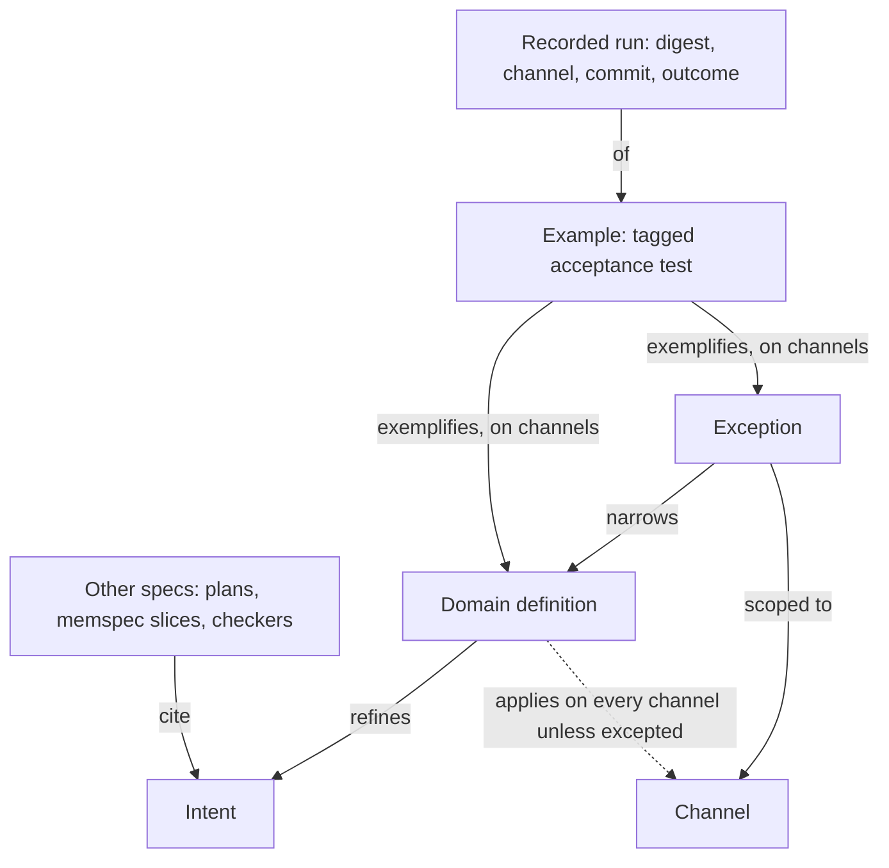

# Intent Catalog - Plan

## Goal Capsule

- **Objective:** A developer working with coding agents can tell, for any commit, which human-approved intents, domain definitions and exceptions are proven by examples that failed before they passed on every channel they apply to, and which are unapproved, stale or unverified.
- **Product authority:** The repository owner approves statements and examples. This plan covers the intent model and its verified-statement report. Execution binding across test frameworks, toolset packaging, code tie-in and an approval UI are not active scope.
- **Open blockers:** None.

---

## Product Contract

### Summary

A typed intent catalog lives in a project's repository next to its code. It holds human-approved intents, the domain definitions that refine them, exceptions that narrow a definition for named channels, and the project's channels, all joined by typed links. The project's own acceptance tests point at the statement they exemplify, and a checker reports which statements are verified at a given commit.

### Problem Frame

Coding agents now write more code than a person can review, so what keeps a system aligned with intent is a check that runs and that agents cannot quietly weaken. Practitioners report the opposite happening: agents delete failing tests or edit them until they pass. Markdown specs record intent but never run. Tests run, but no test is tied to an approved statement, and nothing notices when an approved check changes.

Two cases shaped this plan. In a CRM, the intent "a consultant always knows when to follow up on each open sales process" was first realized as a next-touch date on each sales process. Consultants actually steer by their next task, so the follow-up became the due date of the earliest open task. The intent survived; the meaning of "next follow-up" changed. The old date was read by the dashboard, the filters, inline editing, an import job and several MCP tools, so a browser channel and an agent channel both depended on the old meaning. Nothing recorded which places still used it or whether the passing tests still checked the right thing.

In the second case, an app that serves only browser-authenticated users adds API, MCP and agent clients, and later a public area. "Every request is authenticated by a browser session" turns out to be a mechanism. The intent that lasts is that private data is visible only to an allowed principal. Each new channel, and the public area, is a change someone must approve and that every existing definition must account for.

The existing tools each cover part of this. LemmaSpec evaluates evidence deterministically but has no notion of intent. In `crates/lemmaspec-plan`, requirements are labels, and acceptance claims can attach only to units and gates. memspec links slices and keeps hash-chained history, but it models coupled state, not intent. The surveyed landscape has the same gap: no tool links an approved statement to evidence that its check failed before it passed (`docs/research/2026-10-22-executable-spec-landscape.md`, cross-cutting observations).

### Key Decisions

- **The scope is the intent model.** Execution binding and toolset packaging follow as separate plans that reuse its vocabulary. (session-settled: user-approved — chosen over starting with execution binding or toolset shape: both depend on the intent model's terms.)
- **Domain definitions are a human-approved layer between intent and code.** A change of meaning needs sign-off; a change of code behind an unchanged definition does not. Governs R2, R16. (session-settled: user-approved — chosen over rewriting the intent on every meaning change, or leaving definitions to agents: the follow-up case changed meaning without changing intent.)
- **A definition holds on every channel unless an approved exception scopes it out.** Governs R3, R4. (session-settled: user-approved — chosen over per-channel opt-in, or keeping channels out of intent: a new channel must not silently skip an intent.)
- **The first deliverable is the verified-statement report.** Governs R14, R15, R16, R17, R18, R19. (session-settled: user-approved — chosen over change impact, orphan detection and a channel coverage view: it needs no code facts.)
- **The catalog is a typed, linked format, not Markdown, and examples are the project's own tagged tests.** Typed links let a change be traced to everything that depends on it. Governs R5, R6, R7, R8, R9. (session-settled: user-directed — chosen over a Markdown catalog: references must be checkable so dependent changes can be tracked.)
- **Exceptions narrow definitions, never intents.** An intent that needs an exception is stated at the mechanism level, as "authenticated by a browser session" was. Governs R3.
- **Agents draft; only humans approve.** The catalog must stay agent-driven without letting an agent's edit count as approved. Governs R11, R12, R13.
- **The catalog is an optional companion to LemmaSpec.** A project adopts it one statement at a time, and LemmaSpec without the catalog is unchanged. Governs R20, R21.

### Requirements

**Catalog statements**

- R1. The catalog declares four kinds of statement: intent, domain definition, exception and channel. Each statement has a stable ID and required prose text.
- R2. A domain definition refines one intent and states what a domain term means for the system, such as "a process's next follow-up is the due date of its earliest open task".
- R3. An exception narrows one definition for named channels.
- R4. A definition applies on every declared channel except the channels named by its approved exceptions.

**Links and files**

- R5. Statements link to each other with typed links, and each link points from the dependent statement to the statement it depends on.
- R6. A catalog can span several files that import one another, and a reference across files resolves and is checked exactly like one within a file.
- R7. An unknown reference, a cycle, or a link between the wrong kinds of statement is an error that names the offending reference.
- R8. Artifacts outside the catalog (examples, plans, memspec slices, LemmaSpec checkers) may cite a statement by ID, and the catalog itself never references files or code.

**Examples and runs**

- R9. An example is an acceptance test in the project's own test code that names the definition or exception it exemplifies and the channels it runs on.
- R10. The report reads recorded runs, each naming the example, the example's digest at run time, the channel, the commit and the outcome, and failing runs are kept as evidence.

**Approval**

- R11. Agents may draft and change statements and examples, and approval is a separate, explicit step that records the approver and the digest of the approved text.
- R12. A statement or example whose current text differs from its approved digest is unapproved.
- R13. When a statement changes, every statement and example linked to it becomes stale until a human re-confirms that item.

**Verified-statement report**

- R14. For a given commit, the report gives every intent, definition and exception exactly one standing: verified, unverified, unapproved or stale.
- R15. A definition or exception is verified when it and its examples are approved as they read now and none is stale, and on each channel it applies to, at least one example failed with its current text and passes at the commit.
- R16. An intent is verified when it is approved and every definition refining it is verified, and an intent with no definitions is unverified.
- R17. Every standing other than verified states its reason, such as a missing approval, example, channel or failing run, traced back to the facts it rests on.
- R18. The same catalog, recorded runs and commit always produce the same report.
- R19. The report renders for a human reader, showing each statement's prose, links and standing.

**Adoption**

- R20. A catalog with a single statement produces a useful report, and statements without examples show as unverified without blocking the rest.
- R21. LemmaSpec stays usable without the catalog, and its core gains no dependency on it.

### Acceptance Examples

- AE1. **Covers R15.**
  - **Given:** the definition "next follow-up is the due date of the earliest open task" and its example are approved; the example failed with its current text and passes at the commit on the browser and MCP channels; no exception applies.
  - **When:** the report runs.
  - **Then:** the definition is verified.
- AE2. **Covers R12, R15.**
  - **Given:** AE1, except that an agent edited the example after its failing run, and the edited example passes.
  - **When:** the report runs.
  - **Then:** the example is unapproved and the definition is not verified.
- AE3. **Covers R12, R13.**
  - **Given:** the follow-up definition changes from "the next-touch date the consultant sets" to "the due date of the earliest open task".
  - **When:** the report runs.
  - **Then:** the definition is unapproved, and its examples and the exception narrowing it are stale until a human re-confirms each.
- AE4. **Covers R4, R15.**
  - **Given:** an MCP channel is added to the catalog and approved.
  - **When:** the report runs.
  - **Then:** every definition without an exception for MCP becomes unverified, with the missing MCP example as its reason, until it has an MCP example that failed and then passed.
- AE5. **Covers R3, R4.**
  - **Given:** an approved exception "public pages need no principal" narrows the private-data definition for the public channel and has its own approved example that failed and then passed.
  - **When:** the report runs.
  - **Then:** the private-data definition needs no example on the public channel, and the exception is verified.
- AE6. **Covers R7.**
  - **Given:** an exception links to a definition ID that does not exist.
  - **When:** the catalog is checked.
  - **Then:** the check fails with an error naming the unknown reference.
- AE7. **Covers R16, R20.**
  - **Given:** a catalog holding one approved intent and nothing else.
  - **When:** the report runs.
  - **Then:** the report completes and shows the intent as unverified because no definition refines it.

### Success Criteria

- AE1 through AE7 run as the catalog checker's own fixture and produce the stated standings.
- The checker's mutation policies leave no surviving mutants, so every rule and condition is load-bearing for that fixture.

### Scope Boundaries

**Deferred for later**

- How each test framework tags examples and records runs, beyond the one framework the first version needs.
- Packaging: whether the catalog tool lives with LemmaSpec, with the code-fact extractor, or in a merged toolset.
- Change impact into code and detection of code no approved statement reaches. Both need code facts, and attribute reads such as an ORM column accessor are not resolved call edges today.
- A channel coverage view beyond what the report's standings already show.
- An approval ledger that records why each approval was given; git history is the record for now.
- Semantic comparison of statement versions, such as Cedar's check of whether a new policy version permits more than the old one.
- A TUI or GUI for walking the catalog and approving pending changes.
- Code mutation testing as evidence of how strong an example is.

**Outside this product's identity**

- Generating code from the catalog.
- Counting a model grader's verdict as verification.
- Authenticating approvers.

### Dependencies / Assumptions

- The first version needs a run-recording path that keeps failing runs. The existing status producer turns only passing gates into `observed` facts.
- The repository owner is the only approver at first.
- The catalog records who approved, but cannot prove it. What keeps agents from approving is where approvals happen, such as the owner's commits or a protected path, consistent with LemmaSpec's documented limit that basis metadata does not authenticate authorship.
- Cross-file references follow memspec's import model: `use "<path>" as <alias>`, qualified IDs, cycles rejected, and a file imported along two paths loaded once.

### Outstanding Questions

**Deferred to Planning**

- Does the catalog get its own syntax with first-class statement kinds, or LemmaSpec syntax with a fixed relation vocabulary? Readability favors first-class kinds that project to LemmaSpec evidence.
- Where does the catalog tool live? The default is a crate beside `crates/lemmaspec-plan` unless the packaging work decides otherwise.
- How does a human approve or re-confirm: a command, an approval file, or a signed commit?
- What does a digest cover: prose only, or prose and links, and is whitespace normalized?
- Which test framework does the first version read examples from? The first project to adopt the catalog decides.

<!-- ce-section: work-relationships -->
### How This Work Fits Together

This plan covers the intent model and its verified-statement report. The areas below are the current understanding, not a committed roadmap.

- **Execution binding:** Depends on this plan's statement and example IDs. It supplies recorded runs, including failures, per test framework and channel.
- **Toolset shape:** Can proceed independently of execution binding. Still to decide: whether the catalog tool lives with LemmaSpec, with the code-fact extractor, or in a merged toolset.
- **Code tie-in** (change impact, unreached code, channel coverage): Depends on this plan and on code facts. Shares this plan's link direction, with code-level facts pointing up at statements.
- **Approval UI:** Depends on this plan's approved, pending and stale standings.

### Sources / Research

- `docs/research/2026-10-22-executable-spec-landscape.md`: a survey of the people, tools and practices Dave Farley cites on executable specifications, plus adjacent tools, mapped to intent, executable, design, code-fact, evidence and process layers.
- `docs/research/2026-10-22-behavior-checker-sketch.lemmaspec`: a working LemmaSpec sketch of approval by digest, red then green with unchanged text, orphan scenarios and unrequested code. `walk` is clean, and `mutate` kills 33 mutants with none surviving.
- `crates/lemmaspec-plan/README.md`: the projector, checker and status-composition pattern this work extends.
- memspec `docs/grammar-v0.md`, "Imports": the cross-file reference model.
